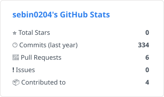
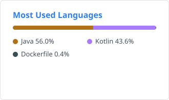

# 👋 Sebin's GitHub

**Spring Boot 기반 백엔드 개발자를 꿈꾸고 있습니다.**
도메인 설계부터 인증, AI 서버 연동, 클라우드 배포까지 서비스의 흐름 전체를 만드는 걸 좋아해요.
Java/SpringBoot 백엔드 공부와 여러 프로젝트를 참여하며 개발 역량을 기르고있습니다.

 

## 🛠 Tech Stack

### Backend
    

### Database

### Infra & DevOps
   

### Tools
    

 

## 📂 Projects

| 프로젝트 | 설명 | 역할 | 기술 |
|---|---|---|---|
| 📚 [**Dual Tales**](https://github.com/sebin0204/Dual-tales) | 다문화 가정을 위한 AI 이중언어 동화 서비스 (GDG SWU Impact Up, 2026.04~05) | 백엔드 전담 — ERD, JWT 인증, AI 서버 연동, Cloud Run 배포 | Spring Boot, MySQL, GCP |
| 💰 [**Toktory**](https://github.com/sebin0204/2026_TRIPLES_TEAM_2_BE) | AI 가계부 서비스 (대학 연합 TripleS 2026, 2026.01~02) | 가계부 · 목표 · 예산 · 소비 패턴 분석 API | Spring Boot, MySQL, Docker |
| 📔 [**그때의 나**](https://github.com/sebin0204/2026_GURU2_TEAM8) | 감정을 기록하고 일주일 뒤 회고하는 감정 일기 Android 앱 (SWU GURU2, 2026.01) | Android(프론트엔드) — 아이디어 제안(채택), 감정·회고일기장, 회고 알림 | Kotlin, Room |

 

## 🌱 Activity
| 기간 | 활동 |
|---|---|
| 2026 ~ 2027 | **GDG on Campus SWU** Core Member |
| 2025 ~ 2026 | **GDG on Campus SWU** Member |
| 2026.01 ~ 2026.03 | 대학 연합 프로젝트 **TripleS** BE

 

## 📜 Certificate

| 취득일 | 자격증 |
|---|---|
| 2026.09 | **SQL 개발자 (SQLD)** |

 

